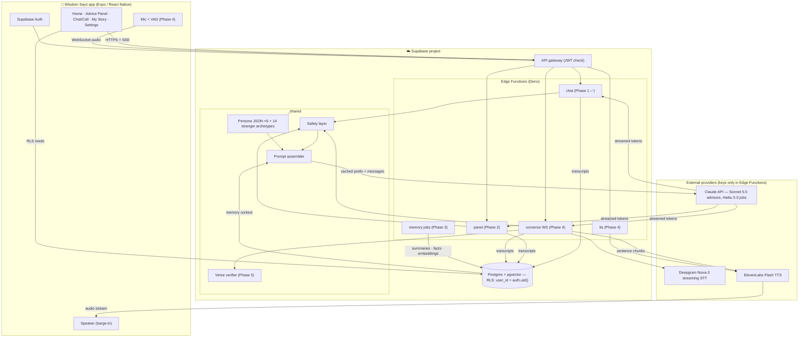

# Wisdom Says (formerly Wisdom Says, Sounding Board and Hearth) — Kickoff: Summary, Stack, Costs, Architecture, Risks

_Prepared 2026-10-13 against the Master Build Prompt (Section 18). Prices were checked against provider pricing pages and third-party price trackers on this date; re-verify before launch._

---

## 1. Product summary

Wisdom Says is a mobile app where an adult can ask any personal question and hear it answered by a cast of AI advisor archetypes: a Mom, a Dad, a Grandma or Grandpa, a Random Stranger with no stake in the outcome, a ten-year-old Kid, an Alien, openly-labeled dramatizations of Julius Caesar, Napoleon, George Washington and Abraham Lincoln, a fictional Elder who marched in the civil rights movement, and Biblical Counsel grounded in Scripture. The signature feature, "Ask the Table," answers one question with every selected advisor in parallel and shows where they agree and differ. Each advisor can then be talked to directly, by text or in a live, interruptible voice conversation in an age- and tone-appropriate voice. Wisdom Says remembers past questions, advice, and outcomes, so later advice builds on the person's real life, while giving them full visibility and control over what is stored. Every advisor is honest about being an AI, never impersonates the user's real family, and steps out of character the moment safety requires it.

---

## 2. Recommended stack

| Layer | Choice | Why |
|---|---|---|
| **Mobile** | **Expo SDK 57 / React Native 0.86 / TypeScript**, Expo Router, dev builds | One codebase for iOS + Android, file-based routing, and native audio modules (needed in Phase 4) via dev builds. Web export works too, which makes CI smoke tests cheap. |
| **Backend** | **Supabase**: Postgres 17 + pgvector, Auth, Edge Functions (Deno), Storage | Auth, RLS, vector search, and serverless functions in one project with a generous free tier. Edge Functions stream SSE and hold the provider keys; the app never sees them. |
| **LLM (advisors)** | **Claude Sonnet 5.5** (`claude-sonnet-5-5`) | $2 / $10 per MTok in/out with 5% cache reads. Best quality-per-dollar for warm, persona-faithful conversation; fast enough for voice. The stable prompt prefix (safety layer + persona) is prompt-cached, so repeated turns cost cents. |
| **LLM (fast jobs)** | **Claude Haiku 5.5** (`claude-haiku-5-5`) | $0.10 / $0.50 per MTok. Used for the safety classifier, session summaries, fact extraction, panel synthesis. |
| **STT** | **Deepgram Nova-3 streaming** (WebSocket), with on-device speech recognition as fallback | Purpose-built streaming endpointing and ~300 ms finalization, which matters more than per-minute price for conversational latency. $0.0048/min promo, $0.0077/min list; budget at list. Cost alternative: OpenAI `gpt-4o-mini-transcribe` at ~$0.003/min (REST, higher latency). |
| **TTS** | **ElevenLabs Flash v2.5** (WebSocket streaming, ~75 ms time-to-first-audio) | Persona distinctness is the product; ElevenLabs has the largest catalog of commercially licensed, age-distinct voices. $0.05 / 1K characters. Cost alternative behind the same adapter: OpenAI `gpt-4o-mini-tts` (~$0.015/min, steerable style prompt, fewer voices) or Deepgram Aura-2 ($0.03 / 1K chars). |
| **Auth** | Supabase Auth: email one-time code (Phase 1), Sign in with Apple + Google (Phase 7) | No deep-link setup needed for codes; Apple requires Sign in with Apple once Google is added. |
| **Push** | Expo Notifications | Follow-ups and Daily Word (Phases 3 and 7). |
| **Payments** | RevenueCat | Subscriptions across both stores (Phase 7). |
| **Analytics / errors** | PostHog (opt-in) / Sentry, both with conversation content scrubbed | Section 10. |

### Per-user cost model (Claude Sonnet 5.5 for advisors, Haiku 5.5 for jobs)

Assumptions: ~2,500-token cached prefix per advisor, ~1,500 uncached tokens (memory + history + question), ~400 output tokens per panel card, ~220 per voice turn. Claude 4.7+ tokenizers produce ~30% more tokens than older ones; the figures below already include that.

| Usage profile | Monthly activity | LLM | STT | TTS | **Total / month** |
|---|---|---|---|---|---|
| Light text | 10 panel questions × 3 advisors, 20 chat turns | ~$0.35 | — | — | **~$0.35** |
| Heavy text | 40 panel questions × 5 advisors, 100 chat turns, memory jobs | ~$2.20 | — | — | **~$2.20** |
| Moderate voice | 120 min of conversation (~100 turns), 20 panel questions | ~$1.40 | $0.35–0.92 | $0.80–2.20 | **~$2.60–4.50** |
| Heavy voice | 300 min of conversation (~250 turns), 40 panel questions | ~$3.10 | $0.90–2.31 | $2.00–5.50 | **~$6.00–11.00** |

Ranges are OpenAI-mini-tts/mini-transcribe (low) to ElevenLabs Flash + Deepgram list (high). Implication for Section 12: a $9.99–14.99/month premium tier with a voice-minute allowance (e.g. 150 min) is sustainable; unlimited voice is not. The `usage` table meters all three from day one.

---

## 3. System architecture

The diagram source is in `docs/architecture.mmd` (Mermaid):

**Request path for a chat turn (Phase 1, implemented):** app → `POST /functions/v1/chat` with the user's JWT → function verifies the user, loads profile, loads/creates the session, reads the last 20 turns, assembles the nine prompt blocks (safety layer → app context → persona → mode → profile → memory → date → history → message) → streams Claude tokens back as SSE `delta` events, withholding the `<<<META>>>` metadata block → persists the advisor message with headline, tone, safety flag, scripture refs, and candidate facts → emits `done`.

---

## 4. Risks and gaps in the spec

1. **Scripture accuracy before Phase 5.** Until the bundled WEB/KJV verifier exists, Biblical Counsel can misquote. Mitigation already in place: the persona rules prefer labeled paraphrase + reference over verbatim quotes, and every passage is listed in `scripture_refs` so Phase 5 can audit history. Do not market the Scripture advisor until Phase 5 ships.
2. **Crisis classification is prompt-only in Phase 1.** The main model self-flags (`safety_flag`) and the app surfaces resources, but the independent Haiku classifier (Phase 6) is the real safety net. Keep the beta small and adult-only until then.
3. **Voice latency budget is tight.** 1.5 s to first audio = STT finalize (~300 ms) + LLM first token (~400–700 ms) + TTS first chunk (~100 ms) + network. It is achievable only with persistent WebSockets, sentence-level TTS flushing, and prompt caching. If a provider regresses, the filler-phrase fallback must be tasteful; test it with real users.
4. **Memory can feel like surveillance.** The spec's "use memory only when it changes the advice" rule is the right one, but the Stranger's default amnesia and the "off the record" mode must be visible and trusted. Build My Story (Phase 3) before public beta so users can see exactly what is kept.
5. **Persona drift toward sameness.** LLMs converge on a safe middle. The persona JSON "avoid" lists and the explicit "disagreement is welcome" instruction help; the blind-identification eval in Section 14 should run from Phase 2 on, not only at launch.
6. **Grief and impersonation edge cases.** Users will try to make "Mom" into their late mother. The safety layer forbids adopting a real person's name, voice, or memories; voice cloning is excluded from v1. Expect this to be the most emotionally charged support category.
7. **Health-data regulation.** Conversations will contain mental-health content. Washington's My Health My Data Act and similar state laws may apply even without HIPAA. Get counsel on the privacy policy before public beta, and keep audio off by default.
8. **Provider data policies.** Confirm, in writing, that Claude API, Deepgram, and ElevenLabs do not train on API traffic under the terms you sign, and list all three in the privacy policy.
9. **App Store review.** AI-companion-adjacent apps get scrutiny. The AI disclosure, in-app deletion, "Report this response," and 17+ rating all need to be in place before submission (Section 11).
10. **Expo + custom native audio.** Expo Go cannot run the Phase 4 audio stack; dev builds (EAS or local) are required from Phase 4 on. Plan for an Apple Developer account and a Mac or EAS Build.

---

## 5. Open decisions taken (Section 17 defaults)

App name Wisdom Says (was Wisdom Says, Hearth) · Expo/Supabase · Sonnet 5.5 + Haiku 5.5 · Deepgram + ElevenLabs (swappable adapters) · WEB default, KJV option · ecumenical lens · Grandma/Grandpa chosen at onboarding · cross-advisor awareness ON · Stranger memory OFF ("Familiar stranger" toggle) · voice audio not stored · freemium · US English · 18+.
